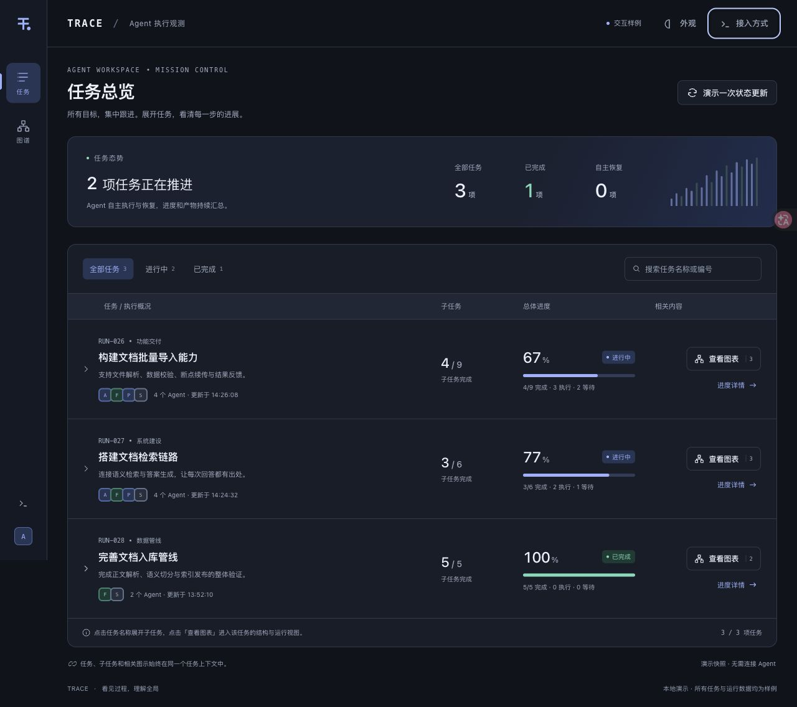
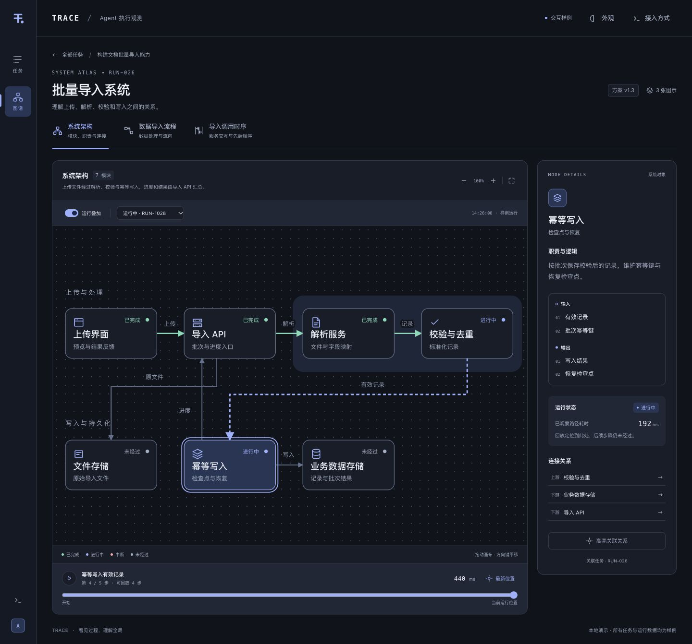

<div align="center">
  
  <h1>Trace</h1>
  <p><strong>看见 Agent 的进展，理解任务的全局。</strong></p>
  <p>在 Mac 上集中跟进 Agent 的任务、子任务和阻塞点，<br />用架构图、流程图和时序图看清它正在构建什么。</p>
  <p><a href="#获取-trace">获取 Trace</a> · <a href="#开始使用">开始使用</a> · <a href="docs/agent-integration.md">接入 Agent</a> · <a href="docs/development.md">开发与构建</a></p>
</div>

<br />



## 多个 Agent，一个清晰的工作台

让 Agent 执行任务时，你需要知道工作推进到了哪里、还有哪些步骤、什么原因挡住了下一步。Trace 把这些信息放在同一个本机工作台里：Agent 持续汇报，你随时查看。

- **跟进所有目标**：主页集中展示任务，展开即可查看嵌套子任务、负责人、完成度与当前进展。
- **找到阻塞点**：筛选「有阻塞」，直接看到受影响的子任务与原因，在详情中查看 Agent 正在采取的处理动作。
- **看清系统结构**：每个任务都能关联架构图、数据流程图和时序图，点击节点了解职责、输入输出与上下游关系。
- **回看执行路径**：Agent 提交运行步骤后，在图上叠加执行状态，回放已汇报的路径。
- **管理任务去留**：在 Mac App 中废弃、恢复或永久删除任务；废弃后仍可查看已有进展。
- **适合日常桌面使用**：支持浅色、深色与跟随系统，任务保存在本机，关闭窗口后仍可继续接收 Agent 汇报。

> **当前为开发测试版。** Mac App 已在 Apple Silicon、macOS 13+ 上验证，目前通过源码构建安装。任务进展和阻塞原因需要 Agent 主动汇报；Trace 根据这些汇报更新界面。

## 从进度，看到背后的结构

任务列表回答「进行到哪一步」，结构图谱帮助理解「各部分如何连接」。可以在同一个任务下切换系统架构、处理流程与调用时序，再叠加 Agent 汇报的运行记录。



## 获取 Trace

| 使用方式 | 获取方式 |
| --- | --- |
| **Mac App** | 从源码构建并安装到 `~/Applications/Trace.app`，详见 [Mac 构建指南](mac/README.md)。运行 App 时无需另外安装 Python。 |
| **浏览器体验** | 使用 Python 3.10+ 启动本机服务，在浏览器中打开工作台。见下方步骤。 |

当前尚未提供可直接下载的发行安装包。Mac 构建需要 Xcode 命令行工具和 python.org framework Python，使用本地签名，尚未完成 Developer ID 签名与公证。

想先看看界面，可从源码启动：

```sh
git clone https://github.com/JackieLeee/trace-agent-observatory.git
cd trace-agent-observatory
python3 agent_trace.py start
```

在浏览器打开 **http://127.0.0.1:8770/**，将顶部数据源切换为「演示样例」，即可体验任务展开、图谱交互和运行回放。演示样例与实际任务分别展示。

## 开始使用

1. 打开 **Trace.app**，应用会自动启动或连接本机服务。
2. 将下方接入提示交给能够执行本机命令的 Agent，让它创建任务、拆解步骤并汇报进展。
3. 在「任务总览」展开任务，查看每个子任务的进度；进入「进度详情」了解当前工作、阻塞点和产物说明。
4. Agent 提交图示后，点击「查看图表」了解任务相关的架构、流程或时序。

可把这段提示加入 Agent 的任务说明：

```text
请使用 ~/.local/bin/agent-trace 汇报本次任务。

先执行 start，为目标创建稳定的任务 ID，通过 plan put 提交子任务、权重和依赖。
在开始、阶段完成、计划调整和最终交付时，通过 task report 如实更新进度。
遇到阻塞时汇报 status=blocked、blocker=具体原因、current=正在采取的处理动作；
继续自主处理，解除后更新为 running 或 done。
需要解释系统结构时提交架构、流程或时序图；实际执行路径通过 run 单独汇报。

命令与数据格式请参阅 Trace 仓库的 docs/agent-integration.md。
```

Mac App 安装器会提供 `~/.local/bin/agent-trace`。从源码运行时，在仓库根目录使用 `python3 agent_trace.py` 替代该命令。完整命令、计划与图示示例见 [Agent 接入指南](docs/agent-integration.md)。

### 管理已有任务

- **废弃**：将任务移入「已废弃」，保留进度和图示；Agent 可以读取，暂时不能继续修改。
- **恢复**：在「已废弃」中恢复任务，Agent 可以接着汇报。
- **永久删除**：确认后移除任务、子任务、图示和运行记录，无法通过 App 恢复；任务中引用的工作文件不会被删除。

这些管理操作在 Mac App 内完成。

## 数据留在本机

Trace 无需注册账户。任务、计划、图示和运行记录保存在 `~/.local/share/agent-trace/`，更新应用会保留数据；停止服务后可以备份整个目录。

关闭窗口或退出 App 后，本机服务继续运行，Agent 仍能汇报。重启电脑后，再次打开 App 即可启动服务。需要彻底停止时，使用 `~/.local/bin/agent-trace stop`。

Agent 可以读取 JSON 任务快照，为交付摘要和周报提供素材。目前尚无完整的子任务变更时间线，按周归属的成果需要结合 Git 或其他记录核实。更多说明见 [数据与 API](docs/data-and-api.md)。

## 开发与构建

Trace 使用 Python 标准库、原生 Web 界面和 Mac 原生窗口。开发运行无需安装 pip 或 npm 依赖。

- [开发与验证](docs/development.md)：源码运行、项目结构和检查命令。
- [Mac App 构建](mac/README.md)：构建环境、安装、更新与平台边界。
- [Agent 接入指南](docs/agent-integration.md)：任务、阻塞、计划、图示和运行汇报。
- [数据与 API](docs/data-and-api.md)：数据目录、接口、权限与当前限制。
